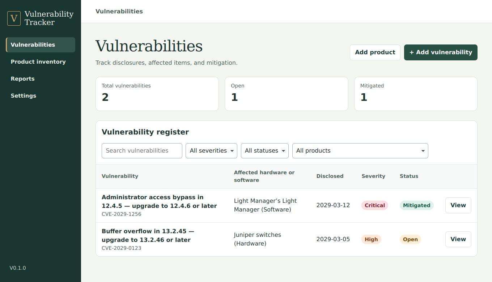
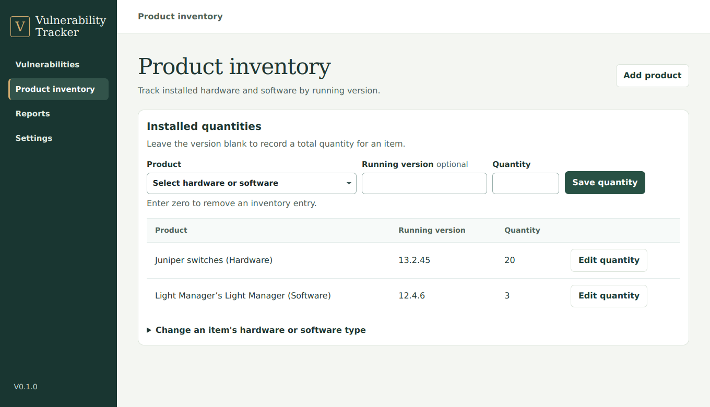
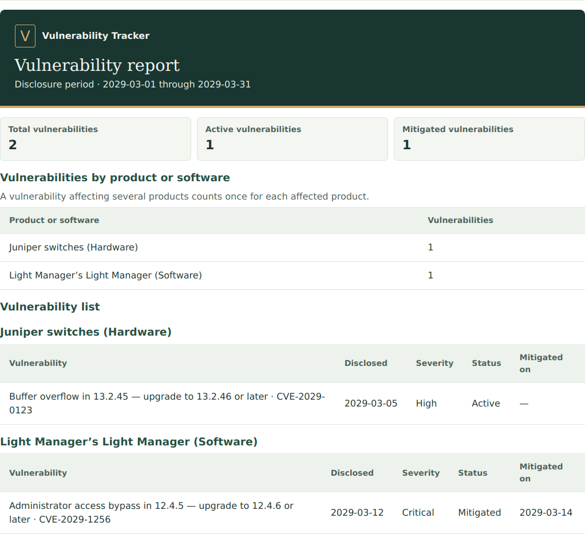

# Vulnerability Tracker

Vulnerability Tracker is a self-hosted register for disclosed vulnerabilities
and their mitigation. Teams can link an advisory to several hardware or
software products, record severity and remediation, and use optional
inventory to see how many installations run each version.

- Search and filter by product, severity, and status.
- Print branded reports or save them as PDFs for a selected disclosure period.
- Customize the app name, organization, logo, and favicon.
- Enable OIDC single sign-on with Microsoft Entra ID, Authentik, or another
  compatible provider.

[Deploy](#deploy-with-docker-compose) · [Sign-in](#sign-in-with-microsoft-entra-id-or-another-oidc-provider) · [Security](SECURITY.md) · [Roadmap](ROADMAP.md) · [MIT License](LICENSE)

## Screenshots

The screenshots use fictional advisories and sample inventory.

**Vulnerability register**



**Product inventory**



**Report preview**



## Deploy with Docker Compose

Install Docker Engine and the Docker Compose plugin. The source repository
is public, so you can clone it and build locally without a GitHub account
or a registry login.

```sh
git clone https://github.com/LaChateau-Holdings-LLC/vulntracker.git
cd vulntracker
cp .env.example .env
docker compose -f compose.yaml -f compose.build.yaml up --build -d
```

Open [http://localhost:8780](http://localhost:8780). SQLite data is stored
in the `tracker-data` named volume. For direct access on a trusted LAN, set
`TRACKER_BIND_IP` in `.env` to the host’s LAN address and recreate the
container with `docker compose up -d`.

For a shared deployment, use an HTTPS reverse proxy and enable required OIDC
after testing sign-in. Review the [security guidance](SECURITY.md) before
making the service available to users.

Use both Compose files for later changes to a source-built deployment.

### Optional prebuilt image

The `linux/amd64` image is available from a private GHCR package. If you
have package access, use a GitHub classic personal access token with
`read:packages` as the Docker login password. Run these commands from a
checkout with `.env` already in place.

```sh
docker login ghcr.io -u YOUR_GITHUB_USERNAME
docker compose pull
docker compose up -d
```

For local development, run `python3 app.py` with Python 3.12 and open
[http://localhost:8080](http://localhost:8080). This stores data in
`data/tracker.sqlite3`. To develop with OIDC, install `requirements.txt`
in a virtual environment and export the settings documented below.

## Record a vulnerability

Choose **Add vulnerability**, add any missing products, and select every
affected product. Enter a title, disclosure date, and any available CVE,
vendor reference, notes, and links. Use **View** and **Edit vulnerability**
to record mitigation. Checking **Mitigated** requires a date and an
explanation of the action taken.

The list can be searched by title, CVE, vendor reference, or product name.
Use the product, severity, and status filters to narrow the results. Mitigation status
applies to the vulnerability as a whole.

## Operations

Use `docker compose ps` to check service status and
`docker compose logs tracker` to view application logs. To upgrade a
registry deployment, set `TRACKER_IMAGE` to the desired version tag in
`.env`, run `docker compose pull`, then `docker compose up -d`. A regular
`docker compose down` preserves the named data volume. The `-v` flag
removes that volume and its records.

See [architecture decisions](DECISIONS.md), [the roadmap](ROADMAP.md),
and [contributor guidance](AGENTS.md).

## Optional product inventory

Use **Vulnerabilities** for advisory tracking on its own. Open **Product
inventory** when you also want to record installed quantities. Both views use
the same product names. Save one quantity per product and running version,
or leave the version blank to record a model-level count. Avoid counting
the same installations in both a version row and an unspecified row.
When installations move to a new release, update both quantities. A quantity
of zero removes that product/version entry.

## Print a vulnerability report

Open **Reports**, set the inclusive disclosure date range, and select the
counts and vulnerability list to include. Empty date fields leave that end
of the range open. Sort the list by product, disclosure date, or title.
Select **Print / Save as PDF** and choose the PDF destination in your browser.

The totals count distinct vulnerability records. A record affecting several
products counts once for each affected product and appears under each product
when the list is grouped by product. Active and mitigated counts use the
current status of records disclosed in the selected period.

Choose **Hardware** or **Software** when adding an item to the shared catalog.
Either type can be selected on a vulnerability and tracked by running version
in inventory. To classify an older item, open **Product inventory** and expand
**Change an item's hardware or software type**.

To create the first inventory entry while adding a product, enter a positive
quantity in **Initial inventory**. Include the running version if known.
Leave both fields blank to add the item to the catalog without inventory.

Choose **Low**, **Medium**, **High**, or **Critical** when saving a
vulnerability. The register can filter by severity, and the report list
includes it. Older vulnerabilities display **Unrated** until you edit them.

## Branding

Open **Settings** to change the application name, organization name, logo,
and favicon. Settings are shared by this tracker instance and stored in its
SQLite database. The application name appears in the sidebar and browser tab.
Reports include the application name, organization, and logo in the header.
Use the restore checkboxes to bring back the default logo or favicon.

## Sign-in with Microsoft Entra ID or another OIDC provider

OIDC requires the tracker's HTTPS address, normally served by a reverse
proxy. Keep the Docker listener private. Start with
[the environment template](.env.example) and add the OIDC settings to your
existing local `.env`. Keep the client secret out of source control.

1. Open **Settings → Sign-in** and expand the provider guide. Register the
   exact callback URL, such as `https://tracker.example.com/auth/callback`.
2. For **Microsoft Entra ID**, create a single-tenant Web app registration
   and set `OIDC_ENTRA_TENANT_ID` to its directory GUID. For **Authentik**,
   create an application linked to a confidential OAuth2/OIDC provider,
   configure its strict redirect URI and an RSA signing key, and set
   `OIDC_ISSUER_URL` to the exact issuer from provider discovery. Set either
   the Entra tenant ID or the generic issuer.
3. Set `OIDC_CLIENT_ID`, `OIDC_CLIENT_SECRET`, and `OIDC_REDIRECT_URI`.
   Set `OIDC_PROVIDER_NAME=Authentik` to display that name on the sign-in
   page when using Authentik.
4. Set `TRACKER_AUTH_MODE=test` and run `docker compose up -d`. Open the
   HTTPS tracker and use **Test sign-in**. Confirm the account and role.
   Tracker data remains accessible without sign-in in this mode.
5. Set `TRACKER_AUTH_MODE=required` and run `docker compose up -d` to
   require sign-in for the tracker and its data API. If setup needs
   correction, an operator can return to test mode in `.env`.

The tracker uses authorization code with PKCE and RS256 ID tokens. For
role-based access, set `OIDC_ACCESS_CLAIM` (defaults to `roles` for Entra
and `groups` for generic OIDC), `OIDC_ALLOWED_VALUE`, and
`OIDC_ADMIN_VALUE`. These values must appear in the ID token. The admin
value also grants tracker access and allows branding changes. Without an
allowed value, provider-authenticated users can access the tracker. Without
an admin value, all permitted users can change branding. Sign out ends the
tracker session. The provider may keep its own session active.

## Feedback and license

Open a GitHub issue for deployment feedback or feature requests. Include
the tracker version and any relevant environment details, using synthetic
examples. Use the private process in the [security policy](SECURITY.md)
for vulnerabilities in the tracker itself.

Vulnerability Tracker is available under the [MIT License](LICENSE).
